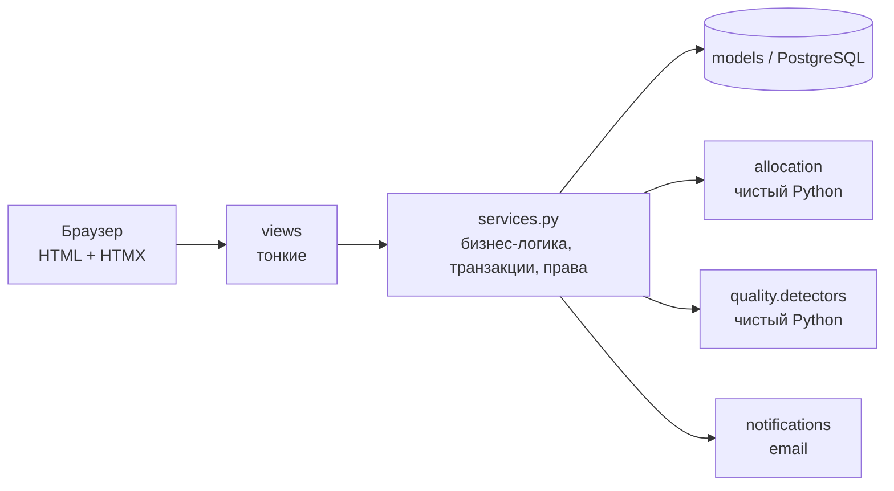
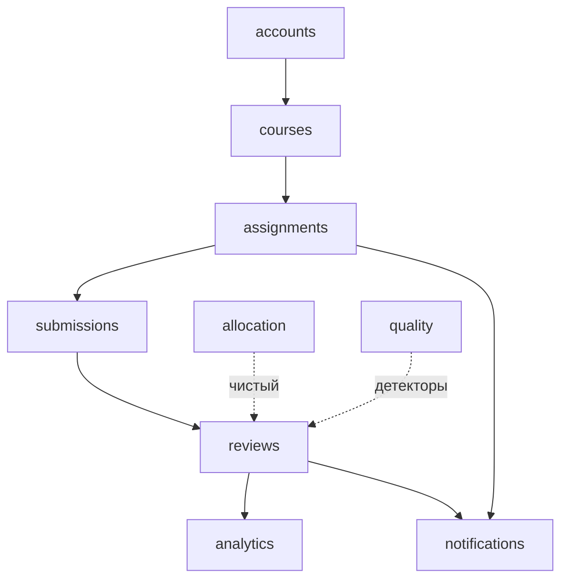
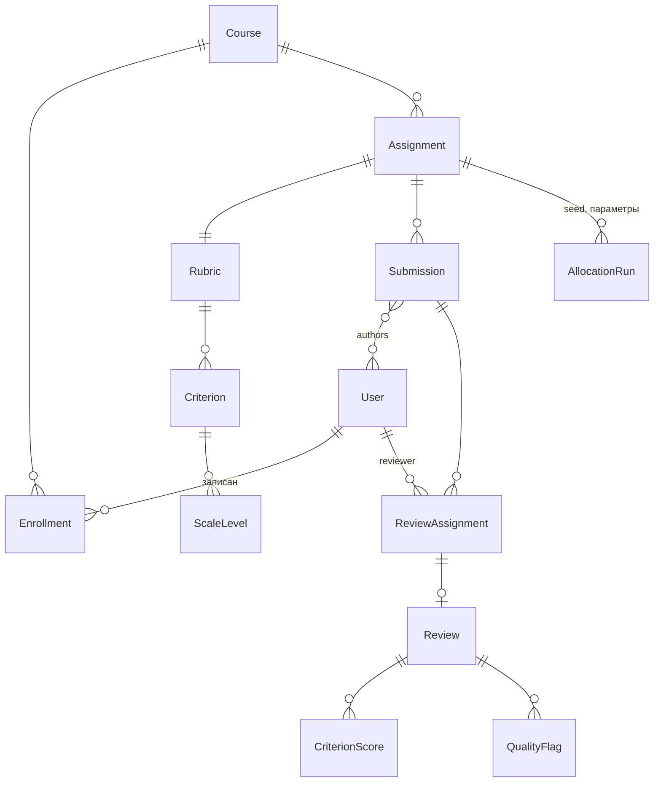

# Архитектура

Монолит на Django 5.2 с серверным рендерингом и HTMX для интерактивности. Обоснование — `adr/0001-django-htmx-monolith.md`.

## Слои

- **views**: разбор запроса, проверка роли, вызов сервиса, рендер (полный шаблон или `_partial.html` для HTMX).
- **services**: единственное место, где меняется состояние. Открывают транзакции, проверяют инварианты и дедлайны.
- **Чистые модули** (`allocation`, `quality/detectors`) не импортируют Django — тестируются property-тестами за миллисекунды.

## Приложения и зависимости

Правило: зависимости только сверху вниз, циклов нет.

## Модель данных (целевая; уточняется задачами через `/model`)

Ключевые поля:
- `Submission.public_code` — случайный код, единственный идентификатор работы, видимый рецензенту.
- `ReviewAssignment(submission, reviewer)` — уникальная пара. Взаимность и самоназначение проверяются сервисом и property-тестами алгоритма.
- `AllocationRun(assignment, seed, k, algorithm, created_at)` — для воспроизводимости.

## Фоновые задачи
Напоминания — management-команда `send_reminders` (идемпотентная, с журналом отправок), запускается по cron или Celery beat. Решение зафиксировать в ADR при реализации T-012.

## Окружения
| | БД | Почта |
|---|---|---|
| dev без Docker | SQLite | консоль |
| dev с `make up` | Postgres 16 | Mailpit :8025 |
| test | SQLite (локально) / Postgres (CI) | locmem |
| CI | Postgres 16 | locmem |
