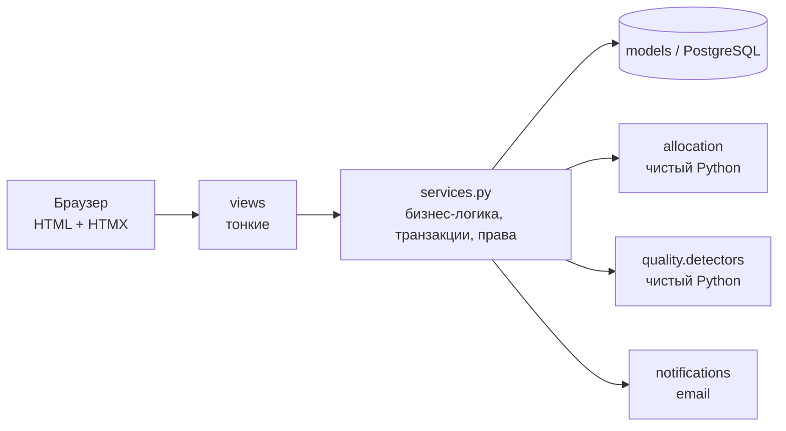
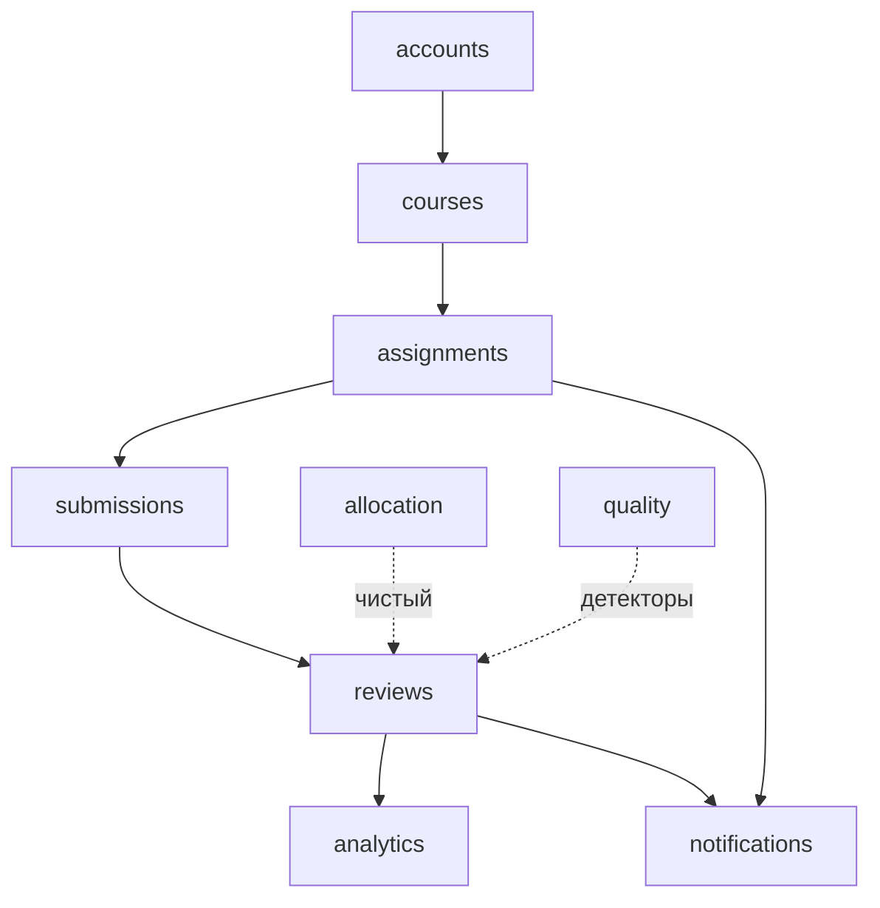
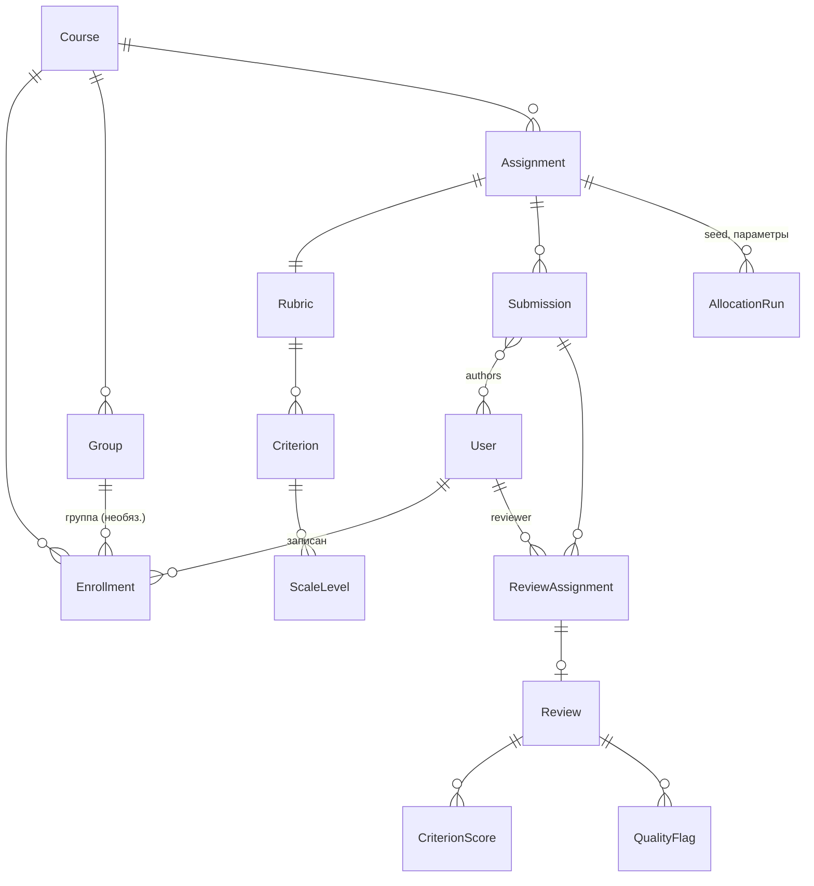

# Архитектура

Монолит на Django 5.2 с серверным рендерингом и HTMX для интерактивности. Обоснование — `adr/0001-django-htmx-monolith.md`.

## Слои

- **views**: разбор запроса, проверка роли, вызов сервиса, рендер (полный шаблон или `_partial.html` для HTMX).
- **services**: единственное место, где меняется состояние. Открывают транзакции, проверяют инварианты и дедлайны.
- **Чистые модули** (`allocation`, `quality/detectors`) не импортируют Django — тестируются property-тестами за миллисекунды.

## Приложения и зависимости

Правило: зависимости только сверху вниз, циклов нет. Исключение — шаблоны: страница курса (`courses`) может включать виджеты нижележащих приложений (``, ``) — она собирает экран из частей. Python-код `courses` не импортирует нижележащие приложения.

## Модель данных (целевая; уточняется задачами через `/model`)

Ключевые поля:
- `Submission.public_code` — случайный код, единственный идентификатор работы, видимый рецензенту.
- `ReviewAssignment(submission, reviewer)` — уникальная пара. Взаимность и самоназначение проверяются сервисом и property-тестами алгоритма.
- `AllocationRun(assignment, seed, k, algorithm, created_at)` — для воспроизводимости.

## Анонимность в views и шаблонах
Инвариант 1 из `CLAUDE.md` в виде правил для экранов работ и рецензий (сформулированы по итогам аудита T-016). anonymity-auditor проверяет каждое.
- **Шапка и текущий пользователь.** Общий шаблон берёт данные только из `request.user`. Ключ `user` в контексте views не используется: он перекрыл бы контекст-процессор, и в шапке рецензента оказался бы автор.
- **Сообщения (`django.contrib.messages`).** Блок сообщений в `base.html` показывается на любом экране. В тексте сообщения работа называется только по `public_code`, без имени, username и id автора или рецензента.
- **Скрытые поля форм.** `_form_fields.html` выводит все hidden-поля формы. В формах работ и рецензий не должно быть скрытых полей с pk объекта или пользователя: привязка берётся из URL по `public_code` и проверяется на сервере.
- **403 и 404 — не оракул существования.** В объектных views для студента «объекта нет» и «объект чужой» дают одинаковый ответ 404 (queryset, отфильтрованный по пользователю, + `get_object_or_404`). 403 — только для проверок роли, не зависящих от объекта. Тест проверяет, что коды ответов в обоих случаях совпадают. Для преподавателя (курсы и задания не анонимны) допустимо «чужой → 403, нет объекта → 404» — так зафиксировано в T-002 и T-003.
- **Узкий контекст на страницах студента.** В студенческие шаблоны не передаются ORM-объекты курса и задания целиком: через них доступны `enrollments`, `owner` и будущие `submissions`. Связи с пользователями — только через сервис с фильтром по текущему пользователю и `public_code`.
- **Тест на экран рецензента.** В первой задаче с экраном рецензента — тест, что username и email автора отсутствуют во всём HTML ответа, включая шапку и сообщения после redirect.

## Фоновые задачи
Напоминания — management-команда `send_reminders` (идемпотентная, с журналом отправок), запускается по cron или Celery beat. Решение зафиксировать в ADR при реализации T-012.

## Окружения
| | БД | Почта |
|---|---|---|
| dev без Docker | SQLite | консоль |
| dev с `make up` | Postgres 16 | Mailpit :8025 |
| test | SQLite (локально) / Postgres (CI) | locmem |
| CI | Postgres 16 | locmem |
