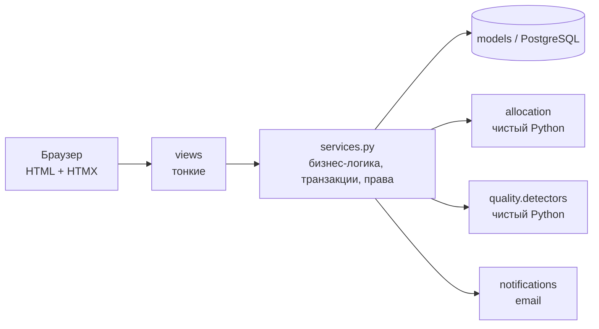
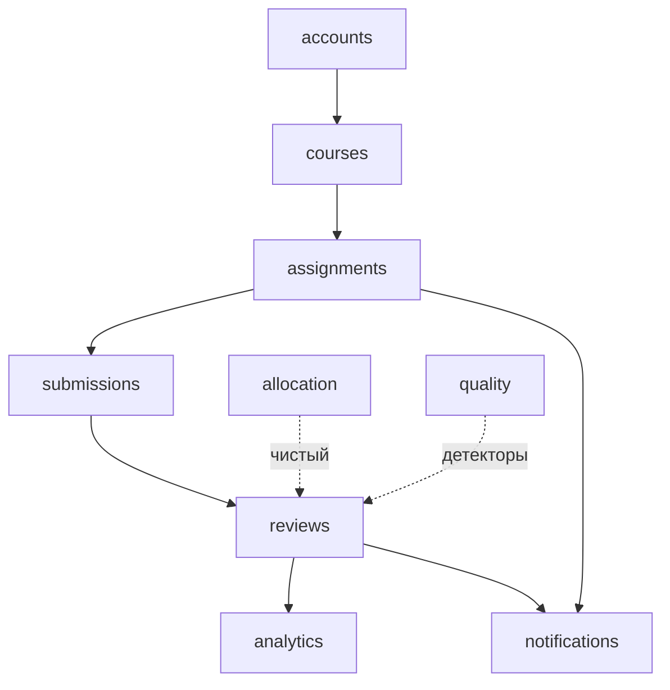
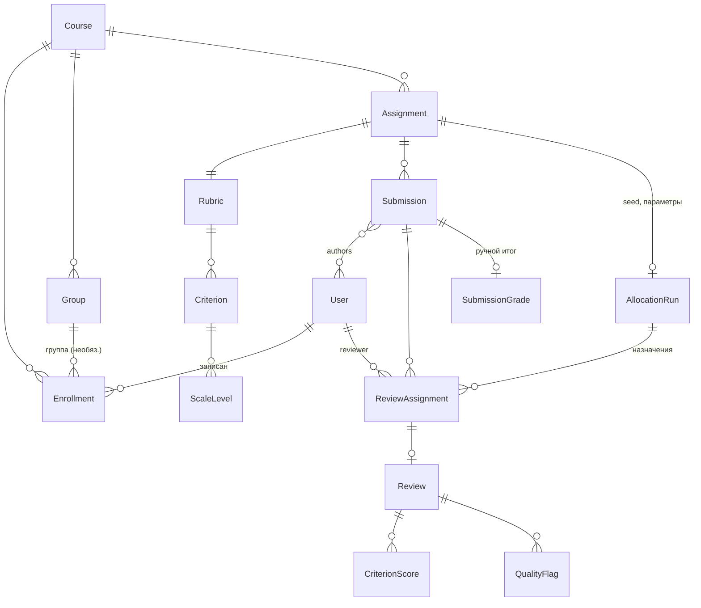

# Архитектура

Монолит на Django 5.2 с серверным рендерингом и HTMX для интерактивности. Обоснование — `adr/0001-django-htmx-monolith.md`.

## Слои

- **views**: разбор запроса, проверка роли, вызов сервиса, рендер (полный шаблон или `_partial.html` для HTMX).
- **services**: единственное место, где меняется состояние. Открывают транзакции, проверяют инварианты и дедлайны.
- **Чистые модули** (`allocation`, `quality/detectors`) не импортируют Django — тестируются property-тестами за миллисекунды.

## Приложения и зависимости

Правило: зависимости только сверху вниз, циклов нет. Исключение — шаблоны: страница курса (`courses`) может включать виджеты нижележащих приложений (``, ``) — она собирает экран из частей. Python-код `courses` не импортирует нижележащие приложения.

## Модель данных (целевая; уточняется задачами через `/model`)

Ключевые поля:
- `Submission.public_code` — случайный код, единственный идентификатор работы, видимый рецензенту.
- `ReviewAssignment(submission, reviewer)` — уникальная пара. Взаимность и самоназначение проверяются сервисом и property-тестами алгоритма.
- `AllocationRun(assignment, seed, k, algorithm, created_at)` — для воспроизводимости.
  Для задания сохраняется один запуск. Сервис блокирует строку задания и одной
  транзакцией записывает запуск, назначения и `allocated_at`.
- При ручном переназначении блокируется та же строка задания и проверяется весь
  граф. Студенту сервис выдаёт только UUID назначенных ему работ. Сведения о
  запуске и причина отказа доступны владельцу задания.
- `Review` связан с назначением один к одному. Черновик и отправка обновляют
  оценки и версию одной транзакцией. Сервис проверяет версию и сроки под
  блокировкой задания. Начатую рецензию нельзя переназначить.
- Для списка работ порядок вычисляется по HMAC от назначения задания,
  рецензента и кода работы с отдельной областью ключа. `AllocationRun.seed`
  для сортировки не используется.
- С дедлайна авторы получают обезличенные данные отправленных рецензий.
  Автоматический итог считается как медиана нормализованных оценок в
  процентах. `SubmissionGrade` хранит ручной итог владельца задания. Если
  запись существует, её значение имеет приоритет, включая нулевое.

## Анонимность в views и шаблонах
Инвариант 1 из `CLAUDE.md` в виде правил для экранов работ и рецензий (сформулированы по итогам аудита T-016). anonymity-auditor проверяет каждое.
- **Шапка и текущий пользователь.** Общий шаблон берёт данные только из `request.user`. Ключ `user` в контексте views не используется: он перекрыл бы контекст-процессор, и в шапке рецензента оказался бы автор.
- **Сообщения (`django.contrib.messages`).** Блок сообщений в `base.html` показывается на любом экране. В тексте сообщения работа называется только по `public_code`, без имени, username и id автора или рецензента.
- **Скрытые поля форм.** `_form_fields.html` выводит все hidden-поля формы. В формах работ и рецензий не должно быть скрытых полей с pk объекта или пользователя: привязка берётся из URL по `public_code` и проверяется на сервере.
- **403 и 404 — не оракул существования.** В объектных views для студента «объекта нет» и «объект чужой» дают одинаковый ответ 404 (queryset, отфильтрованный по пользователю, + `get_object_or_404`). 403 — только для проверок роли, не зависящих от объекта. Тест проверяет, что коды ответов в обоих случаях совпадают. Для преподавателя (курсы и задания не анонимны) допустимо «чужой → 403, нет объекта → 404» — так зафиксировано в T-002 и T-003.
- **Узкий контекст на страницах студента.** В студенческие шаблоны не передаются ORM-объекты курса и задания целиком: через них доступны `enrollments`, `owner` и будущие `submissions`. Связи с пользователями — только через сервис с фильтром по текущему пользователю и `public_code`.
- **Тест на экран рецензента.** В первой задаче с экраном рецензента — тест, что username и email автора отсутствуют во всём HTML ответа, включая шапку и сообщения после redirect.

## Фоновые задачи

Проверки качества обновляются при отправке и изменении отправленной рецензии.
Для закрытых заданий предусмотрен повторный прогон. При развёртывании добавьте
в планировщик, например cron, команду `uv run python manage.py scan_review_quality`
с настройками и окружением проекта. Повторный запуск безопасен для уже
пересчитанных флагов и не сбрасывает отклонение той же версии рецензии.

Напоминания — management-команда `send_reminders` (идемпотентная, с журналом отправок), запускается по cron или Celery beat. Решение зафиксировать в ADR при реализации T-014.

## Проверка понимания (проект расширения)

Требования предложены в [FR-9](SPEC-proposal-mini-defense.md). Новый модуль
`apps/defenses` остаётся в Django-монолите. Он читает материалы из `assignments`,
`submissions` и `reviews`. Дашборд получает узкий DTO статуса и ссылки из
сервиса защиты (T-023). Переход со страницы флагов (T-024) связывается через URL
в шаблоне, чтобы `reviews` не импортировал `defenses`. Расчёт итогов и модерация
остаются в существующих сервисах. Схему защиты первой вводит T-020.

### Сущности и состояние

- `Defense` привязан к `Submission` и конкретному студенту. Роль испытуемого — автор
  или рецензент; для второй роли сохраняется ссылка на конкретную `Review`.
  Сервис проверяет авторство или назначение и принадлежность всех связей одной работе.
- `DefenseQuestion` хранит текст, порядок, происхождение (ручное или из предложения),
  связь с предложением и признак правки преподавателем. При проведении фиксируются
  факт предъявления, результат («самостоятельно», «с подсказкой», «пока не объяснил»)
  и короткий комментарий. Для незаданного вопроса результат пуст.
- В подготовке меняется набор вопросов, при начале он фиксируется. Переходы и запись
  результатов проверяются атомарно. Завершение требует результатов по всем заданным
  вопросам и хотя бы одного заданного. Повторное открытие завершённой защиты вне первой
  версии. Сохраняются авторы действий и время создания, утверждения, начала и завершения.
  `Assignment.phase_at` и `SubmissionGrade` от защиты не зависят.

### Контракты контекста и предложения

1. **Извлечение.** Авторизованный сервис читает файл через закрытое хранилище T-005.
   Результат содержит состояние (`ready`, `unsupported`, `no_text`, `invalid`,
   `limit_exceeded` или `unavailable`), идентификатор содержимого и фрагменты.
   Фрагмент содержит устойчивый ключ, тип и координаты (страница PDF, абзац DOCX,
   диапазон строк TXT), текст. Идентификатор меняется при изменении файла.
2. **Контекст.** Снимок связывает задание, рубрику, идентификатор содержимого и фрагменты
   выбранной работы с отправленными действующими рецензиями этой работы. У источника
   рецензии фиксируются версия и локальная ссылка, у комментария к критерию есть
   свой ключ. Черновики и аннулированные рецензии исключаются. Локальный снимок
   связывает ключи с источниками. Внешний пакет использует ключи снимка без имён,
   email и служебных идентификаторов из БД. Перед отправкой применяется согласованная
   обработка титульников и возможных персональных данных в самих материалах.
   Произвольный текст может сохранять персональные сведения. При невозможности
   безопасно подготовить пакет генерация недоступна, ручная защита работает.
3. **Попытка генерации.** `GenerationAttempt` ссылается на защиту и неизменяемый
   снимок источников, хранит инициатора, поставщика, модель, версию инструкции и
   состояние (ожидает, выполняется, готово, ошибка). Повтор создаёт новую попытку.
   Сетевой вызов не удерживает транзакцию записи. Лимиты времени, объёма контекста
   и числа предложений проверяются на границе адаптера.
4. **Предложение.** `QuestionProposal` содержит текст вопроса, ключ фрагмента и цитату,
   цель проверки и ориентиры ответа. Сервис проверяет структуру, наличие ключа и
   цитаты в переданном снимке. Материалы трактуются как данные, включая инструкции
   внутри документов. Пригодность оценивает преподаватель. Выбор и редактирование
   создают вопрос с сохранением исходного основания и признака правки.

Доступ к карточкам, результатам, снимкам и запуску генерации проверяется по владельцу
курса. Изменения выполняются через POST с CSRF. Студенческие views не получают
внутренние DTO, вопросы, флаги и снимки. Сырые тексты, ответы поставщика и персональные
данные не записываются в обычные логи. Политика хранения и удаления снимков, пределы
извлечения, поставщик, модель, бюджет, зависимости и способ запуска уточняются до
реализации соответствующих задач. После выбора интеграции решение фиксируется в ADR.

## Окружения
| | БД | Почта |
|---|---|---|
| dev без Docker | SQLite | консоль |
| dev с `make up` | Postgres 16 | Mailpit :8025 |
| test | SQLite (локально) / Postgres (CI) | locmem |
| CI | Postgres 16 | locmem |
