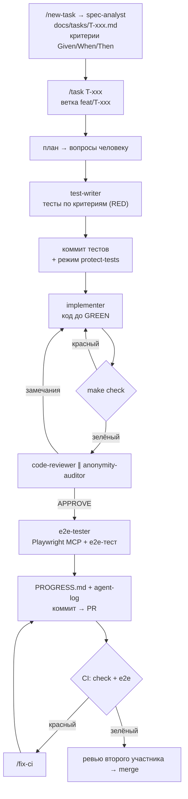

# Workflow разработки с кодинговым агентом

Как устроена разработка: что делает агент (Claude Code), чем он проверяет себя и где участвует человек. Этот документ — основа раздела пояснительной записки о работе с агентом.

## Идея
Агенту недостаточно сказать «не ошибайся». Ему нужна **среда, в которой ошибку видно сразу и её нельзя спрятать**:
1. **Контекст** — что строим и по каким правилам (CLAUDE.md, SPEC, ARCHITECTURE, задачи).
2. **Обратная связь** — инструменты, которыми агент сам проверяет результат (тесты, линтер, типы, браузер).
3. **Ограничители** — хуки, которые детерминированно не дают обойти проверки.
4. **Разделение ролей** — разные субагенты пишут тесты, код и ревью, чтобы никто не проверял сам себя.
5. **Процесс** — один повторяемый цикл на каждую задачу (`/task`).
6. **Следы** — журнал работы агента для отчёта.

## Цикл задачи

## Инструменты обратной связи
| Что проверяем | Инструмент | Когда |
|---|---|---|
| Стиль и типичные баги | ruff | после каждой правки файла (хук) |
| Типы | mypy + django-stubs (strict для ядра) | check-fast, check, CI |
| Поведение | pytest, pytest-django, factory_boy | постоянно |
| Инварианты алгоритма | hypothesis (тысячи случайных входов) | test, CI |
| Качество детектора | eval-набор с метриками precision/recall | test, CI |
| Забытые миграции | makemigrations --check | после правки models.py (хук), check, CI |
| Полнота тестов | coverage ≥ 85% (ядро ≥ 95%) | check, CI |
| Живой UI | Playwright MCP (агент кликает сам) + pytest-playwright | e2e-tester, CI |
| Безопасность | ruff-bandit, pip-audit, check --deploy | make security, CI |

## Ограничители (`.claude/settings.json` + `.claude/hooks/`)
| Хук | Правило |
|---|---|
| SessionStart | агент получает ветку, изменения, хвост PROGRESS.md, активные режимы |
| PreToolUse: guard_files | нельзя трогать `.env`, закоммиченные миграции, харнесс; в режиме protect-tests — тесты |
| PreToolUse: guard_bash | нельзя `--no-verify`, force-push, `reset --hard`, отключать покрытие, читать `.env`, коммитить в main |
| PostToolUse: post_edit | ruff format/fix на файле; напоминание о миграции |
| Stop: stop_check | `make check-fast` — красный → агент возвращается чинить (до 3 раз, затем обязан честно сообщить) |
| Notification | уведомление macOS, когда агент ждёт человека |

Плюс permissions: безопасные команды разрешены без вопросов, `git push`, `uv add`, создание PR — с подтверждением, force-push и `rm -rf` запрещены.

## Субагенты
| Агент | Пишет | Не может |
|---|---|---|
| spec-analyst | `docs/tasks/` | код, тесты |
| test-writer | `tests/` | код приложения |
| implementer | `apps/`, `config/`, шаблоны | тесты (protect-tests) |
| code-reviewer | — (только чтение) | что-либо менять |
| anonymity-auditor | — (только чтение) | что-либо менять |
| e2e-tester | `tests/e2e/` | код приложения |
| report-writer | `docs/report/` | код |

## Скиллы (слэш-команды)
`/task`, `/new-task`, `/review`, `/e2e`, `/fix-ci`, `/model`, `/session-log`, `/report` — описание в `.claude/skills/*/SKILL.md`.

## Работа вдвоём
- Каждый участник ведёт свою сессию агента в отдельном `git worktree` (`git worktree add ../tp-<name> -b feat/T-xxx`), чтобы агенты не мешали друг другу.
- Владение: участник 1 — `allocation`, `reviews`, `quality`; участник 2 — `accounts`, `courses`, `assignments`, `submissions`, `notifications`, `analytics` и UI.
- Merge в `main` — только через PR с зелёным CI и одобрением второго участника.

## Как проверить, что харнесс работает
1. `make check` на чистом клоне — зелёный.
2. Сломать тест и попросить агента закончить — Stop-хук вернёт его чинить.
3. Попросить агента отредактировать `.env` или закоммиченную миграцию — заблокировано.
4. Режим protect-tests: `touch .claude/.state/protect-tests` → правка `tests/…` заблокирована.
5. `/task T-001` от начала до PR.
